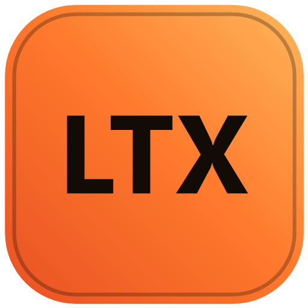
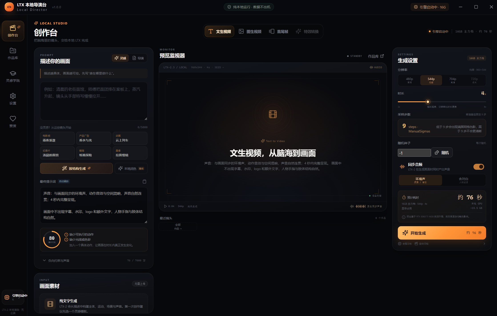
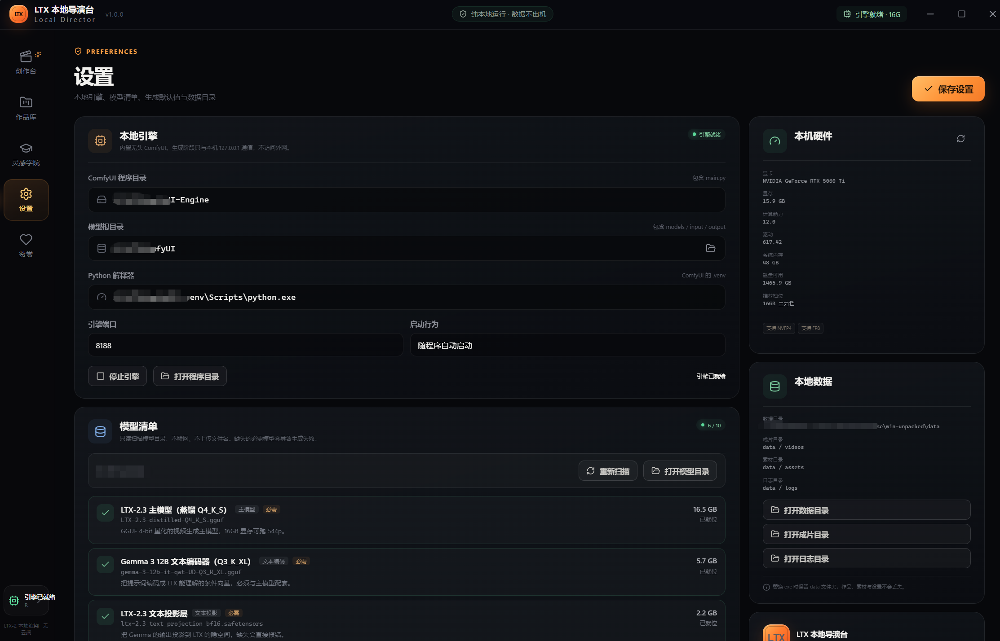

<div align="center">



# LTX 本地导演台 · LTX Local Director

**解压即用的本地 AI 视频生成客户端。**
**A portable, run-anywhere Windows client for AI video generation — 100% on your machine.**


</div>

| 创作台 · Studio | 设置 · Settings |
|---|---|
|  |  |

---

## 简体中文

### 这是什么

LTX 本地导演台是一个**解压即用**的 Windows 客户端：把你的一句话或一张图，交给本机显卡上的 LTX-2 模型，几十秒后得到一条**带同步声音**的 mp4 视频。

没有账号，没有云 API，没有遥测。提示词、素材与成片，全程留在这台电脑上。

- **三种创作模式**：文生视频（T2V）/ 图生视频（I2V）/ 首尾帧（FLF），一次生成画面与声音，输出 mp4（h264 + aac）
- **内置无头 ComfyUI 引擎**：自动检测显卡，按显存推荐档位，自动编排 9 步蒸馏采样工作流
- **便携数据目录**：设置、素材、成片都在 exe 旁的 `data` 文件夹里，拷走即用；不写注册表、不写 AppData
- **本地提示词助手**：结构化编排 + 离线润色全在本机完成，可选择接入离线 LLM 进一步增强
- **显存档位引导**：8G / 16G / 24G / 32G / 64G 五档，界面直接给出预计耗时与显存占用
- **作品库**：本地归档、预览、导出、复用参数、二次创作

### 快速开始

1. 从 [Releases](../../releases) 下载 ZIP，解压到**有写入权限**的目录（不要放在 `C:\Program Files`）
2. 双击 `LTX 本地导演台.exe`
3. 首次启动会引导：检测显卡 → 选择档位 → 检查模型
4. 模型不随程序包提供，按下表放入模型目录（或在设置里指定已有 ComfyUI 目录）
5. 写下提示词，点「开始生成」

> 「无需安装」不等于「无需下载」：程序包约 108 MB，模型需要单独获取（共约 26 GB）。

**运行前提**：Windows 10 / 11 x64 · NVIDIA 显卡（建议 ≥ 8GB 显存）· 驱动与 CUDA 正常

### 显存档位

| 档位 | 显存 | 说明 |
|---|---|---|
| 8G 实验档 | ≥ 8 GB | 480p 草稿可用，仅作验证 |
| 16G 主力档 | ≥ 16 GB | 960×544 稳定直出，推荐起点 |
| 24G 甜点档 | ≥ 24 GB | 704p 高清流畅 |
| 32G 推荐档 | ≥ 32 GB | 720p 最高档 |
| 64G 最佳画质档 | ≥ 64 GB | 高分辨率 + 二阶段放大 |

### 模型清单

必需（缺失会导致生成失败），文件名必须完全一致，扫描器按文件名匹配：

| 角色 | 文件名 | 目录 | 体积 |
|---|---|---|---|
| 主模型 | `LTX-2.3-distilled-Q4_K_S.gguf` | `models/unet` | 16.5 GB |
| 文本编码器 | `gemma-3-12b-it-qat-UD-Q3_K_XL.gguf` | `models/text_encoders` | 5.7 GB |
| 文本投影 | `ltx-2.3_text_projection_bf16.safetensors` | `models/text_encoders` | 2.2 GB |
| 视频 VAE | `LTX23_video_vae_bf16.safetensors` | `models/vae` | 1.4 GB |
| 音频 VAE | `LTX23_audio_vae_bf16.safetensors` | `models/vae` | 0.4 GB |

可选：

| 角色 | 文件名 | 说明 |
|---|---|---|
| 空间放大 ×2 | `ltx-2.3-spatial-upscaler-x2-1.0.safetensors` | 二阶段放大，16GB 档默认关闭 |
| 线稿 IC-LoRA | `ltx-2-19b-ic-lora-canny-control.safetensors` | 特效预留，兼容性待验证 |
| 深度 IC-LoRA | `ltx-2-19b-ic-lora-depth-control.safetensors` | 特效预留，还需深度估计模型 |
| 深度估计 | `lotus-depth-d-v1-1.safetensors` | 景深特效使用 |
| 提示词助手 | `Qwen3-4B-Q4_K_M.gguf` | 可选离线 LLM |

### 默认参数与实测性能

| 项目 | 默认值 |
|---|---|
| 分辨率 | 960×544 |
| 时长 | 4 秒（2–8 秒可调） |
| 帧率 | 24 fps |
| 采样步数 | 9（蒸馏基座固定） |
| 输出 | mp4 / h264 / aac |

16GB 档实测（RTX 5060 Ti，9 步，960×544，4 秒，含冷启动）：

| 模式 | 耗时 | 峰值显存 |
|---|---|---|
| 文生视频 | ≈ 101 秒 | 15.5 GB |
| 图生视频 | ≈ 91 秒 | 15.7 GB |
| 首尾帧 | ≈ 99 秒 | 15.2 GB |

> 冷启动首次加载模型会额外增加约 70 秒。分辨率比时长更贵：+1 秒约 +12%，+一档分辨率约 +44%。

### 隐私

- 生成阶段只与本机 `127.0.0.1` 通信，不访问外网
- 唯一的联网行为是**你主动发起**的模型下载
- 无账号体系、无云端同步、无行为统计、无自动更新
- 打赏二维码为本地静态图，不接入支付、不发起网络请求

---

## English

### What is this

**LTX Local Director** is a **portable** Windows client: give it a sentence or an image, and your own GPU runs LTX-2 locally to produce an mp4 clip **with synchronized audio** — in about a minute.

No account, no cloud API, no telemetry. Your prompts, assets and renders never leave this computer.

- **Three modes**: Text-to-Video / Image-to-Video / First-&-Last-Frame, picture and sound generated together, output mp4 (h264 + aac)
- **Built-in headless ComfyUI engine**: auto-detects your GPU, recommends a VRAM tier, builds the 9-step distilled workflow for you
- **Portable data folder**: settings, assets and renders live in a `data` folder next to the exe — no registry, no AppData
- **Local prompt assistant**: structured composing and offline polish run entirely on-device (optional offline LLM supported)
- **VRAM tier guidance**: 8G / 16G / 24G / 32G / 64G, with estimated time and VRAM shown up-front
- **Library**: local archive, preview, export, reuse parameters, remix

### Quick start

1. Download the ZIP from [Releases](../../releases) and extract it to a **writable** folder (not `C:\Program Files`)
2. Double-click `LTX 本地导演台.exe`
3. First launch walks you through: detect GPU → pick a tier → check models
4. Models are **not** bundled (~26 GB total, see the table above — file names must match exactly)
5. Write a prompt, hit "开始生成" (Generate)

> "No install" does not mean "no download": the app is ~108 MB, models are separate.

**Requirements**: Windows 10 / 11 x64 · NVIDIA GPU (8 GB+ VRAM recommended) · working GPU driver + CUDA

### Measured performance

Measured on an RTX 5060 Ti (16 GB), 9 steps, 960×544, 4 s clip, cold start included:

| Mode | Time | Peak VRAM |
|---|---|---|
| Text-to-Video | ≈ 101 s | 15.5 GB |
| Image-to-Video | ≈ 91 s | 15.7 GB |
| First & Last Frame | ≈ 99 s | 15.2 GB |

### Privacy

- During generation the app talks only to `127.0.0.1` — no external network
- The only network traffic ever is a model download **you** trigger
- No accounts, no cloud sync, no analytics, no auto-update

---

## 开发 · Development

```bash
npm install
npm run dev        # 开发模式 / dev
npm run typecheck  # 类型检查 / typecheck
npm run build      # 构建 / build
npm run build:win  # 打包 Windows x64 便携版 / package portable build
```

开发模式下可用环境变量覆盖引擎路径：

| 变量 | 作用 |
|---|---|
| `LTX_ENGINE_ROOT` | ComfyUI 程序目录（含 `main.py`） |
| `LTX_MODEL_ROOT` | 模型根目录（含 `models/`） |
| `LTX_PYTHON` | ComfyUI 的 Python 解释器 |

技术栈：Electron + TypeScript + React，引擎为无头 ComfyUI（本地 HTTP 驱动），模型基于 [Lightricks LTX-2](https://github.com/Lightricks/LTX-2) 社区量化版。

## 已知限制 · Known limitations

- v1.0 仅支持 Windows x64 · Windows x64 only for now
- 特效模式（IC-LoRA 线稿 / 景深）尚未开放 · Effect modes (IC-LoRA) not enabled yet — 19B weights vs 2.3 (22B) compatibility unverified
- 未接入 LTX-2.5，当前主模型为 LTX-2.3 蒸馏 Q4_K_S · LTX-2.5 not integrated yet
- 应用未做代码签名，首次运行可能触发 SmartScreen 提示 · Unsigned binary — SmartScreen may warn on first run

## 赞助 · Support

如果这个导演台对你有帮助，欢迎请作者喝杯咖啡 ☕
If this project helps you, consider buying the author a coffee ☕

<p>
  
</p>

## License · 许可证

本项目以 [MIT License](LICENSE) 发布。模型文件版权归各自上游所有，请遵循对应模型许可使用。
Released under the [MIT License](LICENSE). Model weights belong to their upstream owners; please follow their licenses.

---

<div align="center">
<sub>LTX 本地导演台 · Your GPU. Your files. No cloud.</sub>
</div>
